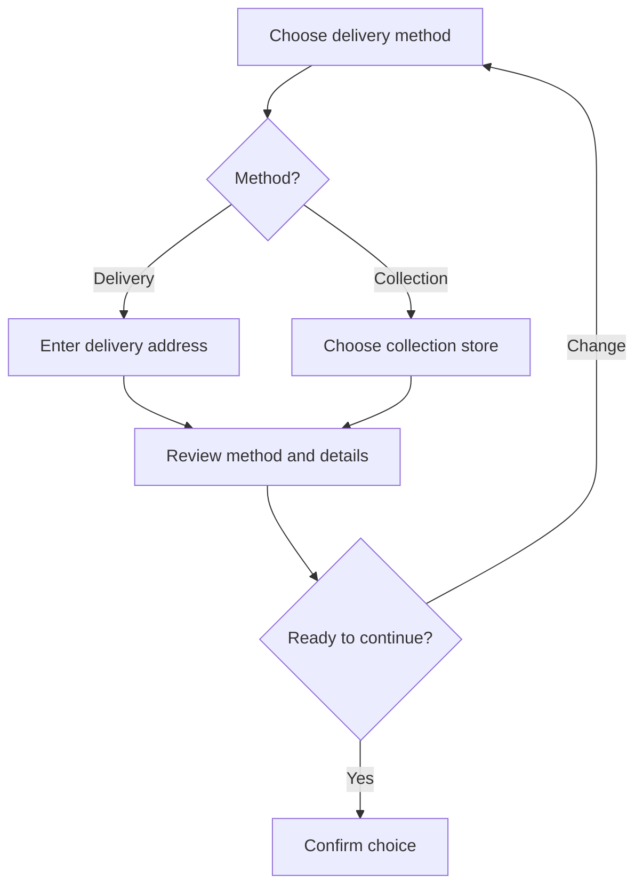
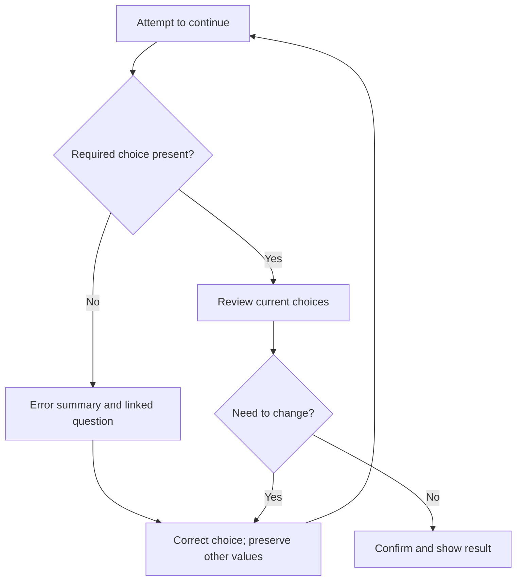

# Vision, memory and cognitive screen-reader UX

**A design and evidence guide for Double FW Ltd · Version 1.0 · 5 November 2026**

## 1. Design the experience conveyed by HTML

A visual layout is only one specification of an interface. Designers must also decide how people discover its structure, identify actions, understand consequences, move between states and recover their place without seeing it. **HTML is a core part of screen-reader UX:** its content, order, semantics and relationships express much of that design. Browser behaviour, CSS visibility, JavaScript, accessibility APIs and the user’s assistive technology complete the experience. Semantic markup is necessary, but markup alone cannot make an incoherent journey understandable.

This guide concerns blind and partially sighted users, including people who also have cognitive, learning or attention-related access needs. Some people combine speech, magnification, residual vision and refreshable braille. Do not equate screen-reader use with total blindness, speech-only output or a single way of navigating.

The aim is to **make information easy to find again, rather than make people remember more**. This includes persistent selections, retrievable instructions, understandable structure and predictable recovery. Think of the interface as a user-controlled conversation with an addressable reference document behind it, rather than a recording that must be heard from start to finish.

The BBC’s [guide to documenting screen-reader UX](https://bbc.github.io/accessibility-news-and-you/guides/screen-reader-ux.html) is a useful starting point: it treats the non-visual experience as a design responsibility and documents order, semantics, content and interaction. Its cautions about verbosity and component/page context are especially relevant. This guide extends that approach with explicit memory demands, multiple entry routes, decision flows and recovery evidence. [R1]

**Companion resources:** [QA evidence matrix](Cognitive_UX_Principles_QA_Evidence_Matrix.md) and [user research and data plan](Cognitive_Accessibility_User_Research_and_Data_Plan.md). CP, CUX and G identifiers below refer to the matrix; they are not WCAG identifiers. All examples in this guide are invented design examples, not observations from completed testing.

## 2. What the “seven items” idea does and does not tell us

### Correct the number before using the lesson

The familiar historical reference is **Miller’s seven plus or minus two**. His 1956 paper considered limits in information processing and the importance of recoding and chunking. It did not establish a universal maximum number of navigation links. [R2]

Cowan’s later review argued for a smaller short-term storage capacity, averaging around four chunks under specified conditions that constrain rehearsal and regrouping. This is not a universal four-option interface rule either. Laboratory memory span, ordered recall, working-memory processing, recognition of a familiar label and choosing from a browsable menu are different tasks. [R3]

For design, the useful conclusion is that memory is constrained and context matters. **Do not turn seven, five or four into a pass/fail threshold.** A long, well-indexed list can be easier than a short hierarchy with unfamiliar categories and repeated backtracking. A two-choice decision can be demanding if its consequences are complex or the information needed to compare the choices is scattered.

### Distinguish the demands

| Demand | Example | Design response |
| --- | --- | --- |
| Ordered recall | Remember the order of eight categories to return to the right one | Stable descriptive labels, navigable groups and direct return paths; do not require an ordinal number |
| Retention | Keep an earlier price in mind while hearing another | Retrievable comparison and selected-item summary |
| Processing | Interpret fees, eligibility and dates while remembering the intended outcome | Plain language, one coherent question at a time, supporting information nearby |
| Prospective memory | Remember to change an address later | Provide the change action at the relevant point; show unfinished tasks |
| Orientation | Remember which step, branch or result is current | Page title, heading, current state and meaningful route context |
| Recovery | Reconstruct a choice after an interruption or validation error | Preserve values, restore an understandable place and expose a review summary |

A “chunk” is meaningful to the person, not simply a bordered box in a wireframe. Experienced customers may recognise “delivery address” as one familiar unit; a new customer may need to understand several unfamiliar requirements within it. Adding category headings does not automatically reduce cognitive load if the categories are ambiguous.

More choice can increase the work of finding, comparing and deciding, especially when alternatives must be consumed in sequence. But choice count is only one factor. Label predictability, similarity, consequence, navigation depth, filtering and comparison support all matter. Retain useful choice and reduce the effort needed to evaluate it.

W3C cognitive guidance recommends processes that avoid unnecessary memory demands. Its memory objective also repeats a broad seven-item description; use its practical recommendations without treating that description as a contemporary universal capacity model. The guidance is supplemental to WCAG, rather than a list of additional mandatory success criteria. [R4]

## 3. Why loss of a visual reference changes the task

A person looking at a comparison can repeatedly glance between a price, a label and a selected option. Someone hearing those pieces one after another may need to retain one while locating another. If headings, relationships or return paths are missing, the interface turns an information-retrieval task into a memory task.

That is a property of the interaction, not evidence of a memory deficit. Research has found advantages in particular verbal-memory tasks among congenitally blind participants; it does not support a blanket assumption that blindness means worse memory. Those findings also do not justify demanding more recall from blind customers. [R5]

Screen-reader use is not limited to sequential reading. Users may move by headings, landmarks, links, form controls, tables, search, touch exploration or braille navigation. Design all relevant routes. A good heading or label becomes an address to which someone can return, reducing the need to retain a long spoken sequence.

### Blindness and neurodivergence can create intersecting demands

A person who cannot use a visual reference may also find sustained listening, working-memory processing, language, sensory stimulation or switching attention demanding. A notification interrupting a choice can then require both recovering the reading position and reconstructing the reasoning. Treat this as a design risk to investigate with relevant users, not a claim that every neurodivergent blind person has reduced memory.

Neurodivergence describes varied people and needs; do not assign one profile to autism, ADHD or dyslexia. Ask what helps and observe the specific task. Some people want concise speech; others need an example, a fuller explanation or a stable repeated cue. Provide discoverable layers and user control rather than choosing one permanent verbosity level for everyone.

| Interaction risk | Better support | Evidence to seek |
| --- | --- | --- |
| Long control names bury the distinguishing information | Brief specific labels with optional relevant descriptions | Can users distinguish actions when navigating by controls alone? |
| A non-critical announcement interrupts reasoning | Coalesce/defer routine updates; retain visible and retrievable status | Can the person resume without rebuilding the task? |
| A step assumes the previous answer is remembered | Local summary with an explicit change route | Can someone verify the answer without leaving the decision? |
| The interface changes silently | Expose meaningful state changes and predictable navigation | Can users identify what changed and what they can do next? |
| Help adds an unfamiliar widget or a lengthy lecture | Contextual, structured assistance with familiar controls | Does assistance reduce effort and enable informed progress? |

Do not automatically increase speech volume, slow someone’s screen reader, change their settings or add sound effects. Preserve their choice of speech rate, verbosity, braille and reading/navigation strategy.

## 4. Congenital and acquired sight loss: experience without stereotypes

Prior visual experience can provide useful remembered associations with layouts, maps or colours. The usefulness varies with age at onset, experience, education, residual vision, task and the person’s preferred representations. Newly acquired sight loss can also mean learning assistive technology and new navigation strategies; visual familiarity does not guarantee a low-effort screen-reader experience.

**No visual memory does not mean no concept.** People learn through language, touch, action, teaching and shared conventions. Research on colour understanding found rich causal knowledge among congenitally blind adults, although some specific colour associations differed from sighted participants. Conceptual understanding and the sensory experience of seeing a colour are distinct. [R6]

Tables are relational data structures, maps represent spatial relationships and colours can carry descriptive or conventional meanings. Their concepts are not exclusive to sight. What often fails is an implementation that communicates the relationship only through position, shading or an unexplained visual analogy.

| Aspect | Useful design question | Assumption to avoid |
| --- | --- | --- |
| Visual history | “Would a spatial overview, a list, a description or another representation help?” | Everyone with acquired blindness remembers or prefers the same visual model |
| Concept familiarity | “How do you normally compare this information or understand this route?” | People born blind cannot understand tables, maps or colour |
| Assistive technology | “Which navigation methods and devices do you use?” | Years since sight loss predicts screen-reader expertise |
| Support preference | “Would you like a short overview or more detail?” | Diagnosis or sight history determines explanation length |
| Interruption/recovery | “What would help you find your place again?” | A strong memory removes the need for persistent context |

Recruit across relevant sight histories and technology experience without requiring participants to disclose more medical history than necessary. A preference can be asked directly; do not collect a diagnosis simply to infer it. Use the companion data plan for sensitive-data handling and optional segmentation.

## 5. Structure as a retrievable reference

W3C page-structure guidance explains how meaningful regions, headings and content structure support navigation and orientation. Use that structure to give people several ways to retrieve the same relevant information. [R7]

### Topic trees and semantic outlines

A topic tree is first an information architecture, not a prescription to implement an ARIA tree widget. A simple nested list of links is often sufficient. Use a treeview only when its interaction model genuinely suits the task and the full expected keyboard/state behaviour is implemented. An ARIA role does not create that behaviour. [R8]

Example topic outline, expressed as a nested list so the relationships are also available in this document:

- Delivery and collection
  - Compare available methods
  - Home delivery
    - Cost and timing
    - Change delivery address
  - Store collection
    - Find a store
    - Collection instructions
  - Review your choice

The outline gives meaningful places to revisit. It does not require the customer to remember that collection was “option three.” For the implementation, map each level to actual page/section headings or nested list relationships, and provide a current-location cue. Avoid an unnecessarily deep category hierarchy: every extra level can add orientation and return work.

### Choose the right structural cue

| Cue | Cognitive purpose | Implementation/design decision |
| --- | --- | --- |
| Page title and main heading | Identify destination and current task | Specific title; task heading and useful step description; update the document title on client-side route change |
| Logical headings | Expose topic hierarchy and return points | Use actual heading levels; keep sibling topics at corresponding levels; do not choose rank to obtain a font size |
| Landmarks | Reach major page areas without consuming intervening content | Use native elements appropriately; distinguish repeated navigation regions; avoid a landmark for every card |
| Nested lists | Preserve related items and parent/child context | Use lists for genuine collections; ordered lists when sequence matters; avoid visual indentation without semantics |
| Fieldset and legend | Keep a question attached to its choices | Group related form inputs; give the group a concise question and each control a proper label |
| Persistent selected-value summary | Remove the need to retain earlier answers | Keep current method, cost and consequences retrievable; provide specific change links |
| Breadcrumb/current-state cue | Explain location within the service | Use meaningful location names and current-page state where appropriate; distinguish hierarchy from task progress |
| Description list | Relate a term or selected field to its value | Use meaningful term/value pairs; do not imitate a table with arbitrary layout containers |
| Disclosure | Offer optional detail without overwhelming the initial view | Make the control and expanded state clear; keep essential decision information available before commitment |

A section element is not automatically a named landmark in every context; a named section can expose a region. A form may expose a form landmark when appropriately named. Specify the intended structure and check actual accessibility output rather than copying a fixed element-to-announcement chart. [R7, R9]

### Descriptive labels that survive different routes

“Change” might be clear next to a visible delivery-address block, but ambiguous in a list of links. Prefer “Change delivery address,” “Change collection store” and “Change delivery method.” Different destinations/actions need distinguishable names; identical repeated actions do not need arbitrary unique suffixes.

Use visible wording where possible, retain it within the accessible name and avoid overriding it with a conflicting hidden label. Put useful distinguishing terms early while keeping natural language and localisation intact. A name identifies; a description provides supporting information. Test whether descriptions are available when needed instead of assuming every screen reader always speaks them. [R10]

## 6. Tables, maps and colour: make relationships available

### Tables: avoid turning comparison into memorisation

Imagine three delivery methods. If the interface presents three long cards in sequence, the customer may have to retain cost, timing and eligibility for the first while reading the last. A well-structured table can permit deliberate row/column comparison, with header associations carrying context. A short summary of the essential difference can help before detailed exploration. Accessible HTML tables use proper header relationships; they do not require visual experience to be useful. [R11]

**Illustrative comparison — fictional service data:**

| Method | Additional cost | Availability |
| --- | --- | --- |
| Home delivery | £4 | Within 3 working days |
| Store collection | £0 | From tomorrow |
| Express delivery | £8 | Next working day for eligible addresses |

A useful summary is: “Store collection has no additional cost. Express delivery is the fastest home-delivery option for eligible addresses.” Keep qualifications explicit; a summary cannot replace essential limitations. Let someone revisit the precise figures and select a method without remembering its position in the comparison.

Document the table caption, header associations and likely comparison tasks. Avoid merged cells and multiple nested header levels when a simpler structure conveys the same meaning. Do not flatten a useful table into an unstructured paragraph merely because it is non-visual. If offering a list view, preserve all necessary relationships and keep equivalent information in sync.

For critical comparisons, also consider a “compare selected methods” view or a persistent current choice. These are proposed design options to test, not universal requirements. A large table may remain cognitively demanding even when its markup is correct.

### Maps: describe the task, topology and actionable details

A customer seeking a collection store needs more than “Map showing stores.” First identify the task: finding an eligible store, comparing access options or following a route. Provide the essential information in a navigable representation, including names, addresses, relevant distances, accessibility information, opening times and selection controls where applicable. A text list must expose the choices and functions of the map, not merely describe its appearance.

For a route, give an overview and then ordered steps with decision points, landmarks and relevant uncertainty. For a network, name connections, direction, transfers and exceptions. A route list alone may not convey the whole spatial relationship; offer an appropriate overview, structured network description, tactile resource or other representation where that relationship matters. Test the actual information need.

Example overview: “Three collection stores are available. Riverside is closest to your chosen postcode. Station Road has the latest closing time.” A specific action is “Choose Riverside store,” rather than “Select the blue pin.” Distance does not establish a safe pedestrian route: avoid inventing navigation assurances or treating an overview as verified wayfinding guidance.

### Colour: keep useful meaning and remove dependence

Do not remove colour names from an experience on the assumption that blind people cannot understand them. A customer may be choosing a green shirt as a gift or coordinating with someone else. Expose colour names and selection state, and include other relevant distinguishing information such as pattern or product identifier.

For functional colour, expose the underlying message: “Payment failed,” not “the red state”; “Available,” not “green.” A chart needs identifiable series and the data relationships needed for the task. The customer should not have to remember a spoken legend and match it to unrelated labels later. Research on colour concepts supports avoiding a deficit assumption; it does not make colour-only communication accessible. [R6]

## 7. Design the logic as an audio script

An audio-script review asks: **if this information arrives over time, does each decision have its context, alternatives and consequences when they are needed?** This is a design method, not a recommendation to replace the screen reader with a recorded voice, an audio overlay or browser speech synthesis.

Speech is one output of a semantic interface. A braille user also needs concise names, relationships and stable state; a speech transcript alone cannot verify braille usability. Likewise, a transcript cannot establish focus behaviour, reading navigation or meaningful relationships.

### Four layers to document

| Layer | What the designer specifies | What must remain flexible |
| --- | --- | --- |
| Meaning | The question, action, essential consequence and available reference information | The user’s pace and preferred amount of optional detail |
| Semantic contract | Name, role, value, state, group/heading relationships and relevant description | Screen-reader phrasing and the order in which role/state may be spoken |
| Interaction | Trigger, state transition, focus strategy, announcement and return path | User-selected reading/navigation strategy |
| Example output | A representative short listening sequence and braille/state notes | Exact speech string, punctuation pronunciation and verbosity settings |

Specify **semantic invariants**, not one universal transcript. For a collection option these might be: name includes the store; role is the appropriate choice control; checked state is accurate; relevant cost/timing is available; selecting it does not unexpectedly navigate. Actual speech may arrange those elements differently.

### Editorial rules for the script review

- Give the task and distinguishing information before optional background.
- Place consequences and relevant instructions before the commitment that needs them.
- Use meaningful transitions when the context changes; avoid repeated page introductions after every small update.
- Keep a short current-choice summary that can be revisited. Persistence means retrievable content, not forced repeated speech.
- Coalesce routine updates; do not speak every character, price recalculation or decorative state change.
- Reserve interruption for a justified urgent need. A live-region message must not compete unnecessarily with focused content.
- Make errors identify the problem and remedy while preserving useful input.
- Check whether a person who enters midway through a heading, control list or search result has enough context.

### Example: how a memory trap sounds

**Problematic design, illustrative paraphrase:**

> “Delivery options. Standard… more information… four pounds… Collection… more information… free… Express… more information… eight pounds… Continue.”

The user has to bind prices to methods, discover what repeated links refer to and remember a choice before knowing its consequences. The improvement is not to read all of it louder, repeat it twice or impose a maximum of seven options.

**Better design intent:**

> “Choose how to get your order. Compare costs and timing. Home delivery: four pounds, within three working days. Store collection: no additional cost, from tomorrow. Express delivery: eight pounds, next working day for eligible addresses.”

Each option remains a directly navigable, correctly labelled choice. Essential conditions are available at the control. The comparison and selected summary remain retrievable; this paragraph is not one forced announcement.

## 8. Worked example: a user flow with decisions and recovery

### Scenario and state model

The customer chooses delivery or collection, selects a store if needed and reviews the choice. Nothing in this example is a live purchase. Method labels, cost, selected store and relevant conditions persist in a reviewable summary.



**Text equivalent:** Choose a method. Delivery leads to an address; collection leads to a store choice. Both lead to review. The customer can change the method while retaining still-relevant values or confirm the reviewed choice. The change route must explain if a previous selection becomes unavailable; it must not silently reuse an incompatible value.

This flow shows destinations and branching. It does not yet specify what the customer can discover, what is spoken or how focus behaves. The state record and script below supply those missing decisions.

### Screen-reader UX state record

The proposed focus strategy below concerns **client-side task transitions**. Normal full-page navigation should retain appropriate browser behaviour; do not add focus jumps on initial load simply to force a script.

| State / trigger | Discoverable context and control | Focus / reading / feedback decision | What the user should not have to remember |
| --- | --- | --- | --- |
| S1: method step entered | Specific page title, H1 “Choose delivery method”; labelled radio group; comparison reference | On an internal step transition, move focus to the step heading under the chosen route strategy; retain logical source order | Purpose of the step, available methods or their ordinal positions |
| S1: method changed | Actual checked state; price/timing associated with option; current-choice summary | Keep focus in the choice group; do not automatically advance. Add a concise status only if significant information would otherwise be missed | Which option is selected and what it means |
| S2: collection continued | H1 “Choose collection store”; list of named stores and associated details | Move to the new step heading; provide store search/list and an equivalent map route where used | The chosen method or the meaning of an unnamed pin |
| S2: store selected | Checked state and store-specific collection details; explicit Continue control | Keep focus on the selected choice; make the summary retrievable | Which store was selected or its opening constraints |
| S2: no store chosen on submission | Error summary links to the relevant question; concise field/group error | Move focus to error summary for this chosen form pattern; let linked errors lead to the question/control; do not duplicate the whole error as a second forced alert | Where the error occurred or how to correct it |
| S3: review entered | H1 “Review delivery choice”; labelled method/store/cost values; specific change actions | Move to the review heading under the route strategy; allow headings, reading and control navigation | Earlier prices, store identity or which action changes what |
| S3: change store | Existing selected store and editable alternatives | Return to the store step with its selection preserved; choose a predictable target and expose context | The previous answer or route back to review |
| S4: confirmation | Explicit outcome and next action; reference details as needed | Confirm success in the chosen navigation pattern; do not make the user infer success from disappearance of the form | Whether their choice was actually saved |

For every programmatic focus target, specify the implementation and verify that it can receive focus appropriately. A heading focused on a route transition may use `tabindex="-1"`; do not put every heading into the sequential Tab order. Document what happens to the reading cursor as observed on supported screen readers, rather than claiming DOM focus and the reading position are identical.

### A script extract with a semantic contract

These are illustrative author-written expectations, not exact strings to force onto every device.

| Moment | Example meaningful output | Contract / recovery |
| --- | --- | --- |
| Enter S1 | “Choose delivery method”, heading; question and choices available | The H1 identifies the task. The group question remains available when navigating its controls |
| Navigate collection choice | “Store collection — no additional cost, from tomorrow”, radio option and current checked state | Method, cost, timing and state are available together; native role/state is not duplicated inside the label |
| Continue to S2 | “Choose collection store”, heading | Method remains selected; store details can be explored without memorising a map |
| Missing selection | “There is a problem. Choose a collection store.” | User can reach the question directly; existing method stays selected |
| Reach S3 | “Review delivery choice”; method, store and cost in labelled pairs | “Change collection store” identifies its action even in a links list |
| Confirm | “Collection choice saved” with useful next information | The result is explicit and can be revisited; it is not only a transient sound |

### Recovery flow



**Text equivalent:** Submission checks the required choice. If missing, the customer receives an error summary and a direct route to correct the question without re-entering other valid data. Valid choices reach review, where the customer can change them or confirm. This example shows the logical recovery; actual change routes return to the relevant step, not an arbitrary page start.

## 9. Make the specification concrete in HTML

Prefer native HTML for its built-in semantics and interaction. ARIA can express missing relationships and state but does not supply event handling, keyboard behaviour or a coherent information architecture. Test the combined implementation. [R9]

The following are **static excerpts**, not a complete working form or application. URLs, data persistence, validation and route handling require implementation and testing against the state record.

### Question, options and a persistent reference

```html
<main id="main">
  <h1>Choose delivery method</h1>
  <p>You can review your choice before confirming it.</p>

  <fieldset>
    <legend>How would you like to get your order?</legend>
    <div>
      <input id="home" type="radio" name="method" value="home"
             aria-describedby="home-details">
      <label for="home">Home delivery</label>
      <p id="home-details">£4. Within 3 working days.</p>
    </div>
    <div>
      <input id="collect" type="radio" name="method" value="collection"
             aria-describedby="collection-details" checked>
      <label for="collect">Store collection</label>
      <p id="collection-details">No additional cost. From tomorrow.</p>
    </div>
  </fieldset>

  <h2>Your current choice</h2>
  <dl>
    <dt>Method</dt><dd>Store collection</dd>
    <dt>Additional cost</dt><dd>£0</dd>
  </dl>
  <button type="button">Continue to choose a collection store</button>
</main>
```

The summary must update from the same underlying state as the checked control. This excerpt shows two options to illustrate the pattern; the comparison in section 6 has three. An actual service must present and keep all applicable choices consistent.

The native label names the control and the description relates its details. Because descriptions may be configured differently, keep essential details visible, adjacent and available in reading navigation; verify that a control-only route also provides enough information. If essential cost information is missed on target configurations, revise the label/association and re-test rather than assuming `aria-describedby` solves it everywhere. Do not append “radio button” or “selected” to author-written labels; expose real state.

The heading for the selected summary provides a return point. Do not make the entire page or summary a live region. Choose any necessary announcement separately and avoid repeating what the user has just heard from the focused control.

### A comparison with explicit relationships

```html
<table>
  <caption>Delivery methods: additional cost and availability</caption>
  <thead>
    <tr>
      <th scope="col">Method</th>
      <th scope="col">Additional cost</th>
      <th scope="col">Availability</th>
    </tr>
  </thead>
  <tbody>
    <tr>
      <th scope="row">Home delivery</th>
      <td>£4</td>
      <td>Within 3 working days</td>
    </tr>
    <tr>
      <th scope="row">Store collection</th>
      <td>£0</td>
      <td>From tomorrow</td>
    </tr>
  </tbody>
</table>
```

A table-navigation user should be able to recover the relevant method/header context when exploring a cell. Exact repetitions depend on screen-reader settings. Test relationships, not whether one device says a prescribed sentence. Preserve these semantics in responsive rendering; hiding headers or replacing cells with styled generic containers can remove the reference structure.

## 10. Designer documentation: five complementary views

The VA.gov annotation guidance provides examples covering headings, reading order, focus, feedback, labels and other accessibility decisions in design files. These annotations communicate design intent before implementation. They complement, rather than replace, a semantic prototype and task evaluation. [R12]

| Design view | What to show | Decision it makes reviewable |
| --- | --- | --- |
| Topic/semantic outline | Titles, heading levels, regions, groups, lists and reference points | Can a user understand the shape of the information and return to it? |
| Annotated screen | Numbered source-reading order; separately marked focusable controls; labels/descriptions; hidden/decorative content decisions | What does visual styling communicate that must also be expressed semantically? |
| Task decision flow | Branches, prerequisites, consequences, review/change/cancel and safe recovery | Does each choice have the information needed when it is made? |
| State/script record | Trigger, previous/new state, name/role/value/state, focus, feedback and restoration | Does the experience remain coherent after interaction? |
| Memory-demand record | Information the person must retain, competing work and available retrieval routes | Have we unnecessarily converted reference information into recall? |

Use shared component IDs across all five views. Put essential decisions in accessible text, not only coloured pins on a canvas. Annotated PDF or image exports need an accessible equivalent; a structured document or HTML specification can serve as the canonical record. Link to reusable component contracts rather than copying instructions into many screens that later diverge.

### Reusable component annotation record

| Field | Example for a delivery-method question |
| --- | --- |
| Component / context | delivery-method-group; S1 choose method; complete page context linked |
| User purpose | Choose an available method with understood cost and timing |
| Structure / relationships | Fieldset/legend, native radios, associated detail text, retrievable current summary |
| Reading and focus order | Source order question → option/detail pairs → summary → Continue; native radio-group keyboard model |
| Names and descriptions | Visible method labels; associated cost/timing; no conflicting hidden names |
| State / behaviour | Checked state matches data; selecting does not submit or advance |
| Feedback | Routine selection state handled natively; announce additional remote availability result only if needed |
| Recovery | Preserve selection after errors/back; restore useful context after route changes |
| Entry routes | Continuous reading, heading jump, control navigation and touch/braille use as relevant |
| Memory risk | Cost/method binding and earlier choice; summary/comparison removes unnecessary retention |
| Evidence | DOM/accessibility inspection, manual AT task trace and relevant user findings |
| Owner / version | Designer, engineer, content owner, test reviewer and revision |

### Example memory-demand record

| Decision | Unnecessary retention in a weak design | Retrievable support | Trade-off / test |
| --- | --- | --- | --- |
| Compare cost | Method names and prices scattered across separate screens | Structured comparison and selected summary | Does a comparison table or alternative view help the intended users? |
| Choose store | Name, availability and distance must be matched from pins | Named list items with details and explicit choice controls | Can users distinguish stores without listening to every repeated phrase? |
| Correct error | Previous answers disappear while an error is explained | Preserved values and linked error summary | Can users recover without guidance or re-entry? |
| Resume after a pause | Stage and selection must be reconstructed | Task heading and current-answer summary | Does reorientation help without forcing a repeated introduction? |

Do not turn this record into an invented numerical “cognitive load score.” Word counts, time to reach information and repeated announcements can indicate problems, but do not directly measure a person’s working-memory capacity.

## 11. Review and test the cognitive screen-reader experience

### Review beyond a single listening run

1. Read the semantic outline alone. Check whether its labels explain the task and distinguish related topics.
2. Review the audio-script intent for missing context, duplicated speech and consequences revealed too late.
3. Inspect the implemented DOM and accessibility output, including hidden/expanded states and responsive variants.
4. Test actual supported screen-reader/browser/device combinations. Record versions, settings, navigation mode and input/output method.
5. Use several entry routes: continuous reading; heading/landmark navigation; controls/links list; table exploration; touch and braille where relevant.
6. Exercise loading, error, back, change, timeout and resume states. Check saved values, location and control.
7. Evaluate realistic tasks with people whose relevant needs vary, including intersecting vision and cognitive needs. Observe understanding, effort and recovery, not just whether speech occurs.

A sighted designer listening with the screen hidden can find sequencing problems, but this is not a simulation of being blind or a substitute for user research. Retain sighted screen-reader users in scope too: conflicting visual and spoken labels/order can be especially confusing. Do not force participants to use a particular speech rate or navigation route to match the designer’s imagined script.

### Evidence matrix for this guide

These local check IDs are new guide-level review prompts, not existing QA repository IDs. CUX links identify relevant evidence assertions in the companion matrix.

| Local check | Question / expected outcome | Evidence and method | Companion link |
| --- | --- | --- | --- |
| VMR-01 Structure | Can the task/topic be located using headings or landmarks without replaying all earlier content? | Semantic outline, actual navigation trace and task observation; automated structure checks are partial | CUX-18, 24 |
| VMR-02 Distinct controls | Can actions/destinations be distinguished when encountered out of context? | Computed names plus link/control navigation; human meaning review | CUX-04, 05, 11 |
| VMR-03 Comparisons | Are essential alternatives/values available together or readily retrievable? | Task comparison and table/header or alternative-view tests; user comprehension | CUX-13, 19, 21; G-01/02 |
| VMR-04 Selected state | Can the customer verify current choices without remembering a prior screen? | State/data consistency, persistent summary and user verification | CUX-06, 22–24 |
| VMR-05 Feedback | Are meaningful changes discoverable without unnecessary competing speech? | Event/announcement trace; interruptions and recovery observation | CUX-29–32; G-05 |
| VMR-06 Correction/resume | Can someone recover after an error or pause with values and context intact? | Error/back/resume traces; participant task outcome | CUX-12, 23–25; G-02/03 |
| VMR-07 Equivalent representations | Can users obtain the map/table/colour information needed for the actual task? | Information/function inventory and cross-representation comparison | CUX-13–16, 21, 35 |
| VMR-08 Real variation | Does the design support relevant sight histories, technology experience and intersecting needs without assuming one profile? | Recruitment coverage, optional preferences and disaggregated qualitative findings | G-01/02/06; companion research plan |

Record expected outcome, actual observation, result, environment, evidence link, limitation, owner and retest. Keep “not tested,” “cannot tell” and “not applicable with reason” distinct. A clean automated scan does not establish any whole row above.

Use the companion plan’s satisfaction domains to investigate Navigation, Task Completion, Task Time Expectation, Content Consumption and User Preference Support. Add observed context loss, repeated retrieval, assistance and misunderstanding. Repeated retrieval is not automatically failure: a good reference lets the customer check as often as they wish. Investigate avoidable search and inability to regain context rather than punishing healthy verification.

Agree task-specific acceptance criteria before research. For example: the customer can verify the selected method/cost and change it using available information without moderator prompting. Do not require recall after hiding the very summary intended to remove that demand. Do not claim a design fails because a person could not repeat seven labels in order.

## 12. Delivery checklist and ownership

A design handoff is ready for implementation when the task flow, semantic outline, component contracts, state/recovery record and memory-demand review are agreed by design, content and engineering. A delivery claim needs implemented behaviour and user evidence in the tested scope.

- **Design:** define structure, decisions, comparable routes and retrieval of context; maintain annotation/script records.
- **Content:** provide clear labels, consequential information, concise feedback and consistent terminology across representations.
- **Engineering:** implement native semantics and necessary state/focus behaviour; keep data, DOM and accessibility output aligned.
- **QA:** verify supported routes/states on actual AT and retain reproducible observations, not only scanner results.
- **Research:** include relevant variation and investigate comprehension, interruption and recovery with real users.
- **Product owner:** resolve barriers and unsupported scope; do not treat a script read-through or numerical menu limit as proof of delivery.

An authorised AI agent can inspect structure, flag repeated/ambiguous names, generate draft state records and check DOM/state consistency. It can help redact and organise evidence under the companion data plan. It cannot infer lived comprehension, diagnose memory impairment or replace blind/neurodivergent participants with simulated personas.

## 13. Sources and how to use them

Checked 5 November 2026. Research findings below have study-specific limits. Recommendations and fictional examples in this guide are a design synthesis, not claims that one paper proves a particular interface pattern. W3C tutorials/APG and cognitive supplemental guidance have different roles; this guide does not convert them into new WCAG requirements.

- **R1 — BBC documentation method:** [How to document the screen reader user experience](https://bbc.github.io/accessibility-news-and-you/guides/screen-reader-ux.html). Useful for communicating non-visual design intent; verify detailed implementation against current guidance and actual AT rather than treating example announcements as guarantees.
- **R2 — Historical memory reference:** Miller (1956), [The magical number seven, plus or minus two](https://doi.org/10.1037/h0043158); [author-permitted full-text reproduction](https://cse.buffalo.edu/~rapaport/575/F01/miller56.html). Memory/information-processing research, not a navigation-link standard.
- **R3 — Later capacity analysis:** Cowan (2001), [The magical number 4 in short-term memory](https://pubmed.ncbi.nlm.nih.gov/11515286/). Read the boundary conditions; do not substitute a universal four-choice rule.
- **R4 — Memory in cognitive accessibility:** W3C, [Ensure processes do not rely on memory](https://www.w3.org/WAI/WCAG2/supplemental/objectives/o6-memory/). Practical supplemental design objective; its broad numerical description is not used as a threshold here.
- **R5 — Blindness and verbal memory:** [Superior verbal but not nonverbal memory in congenital blindness](https://pmc.ncbi.nlm.nih.gov/articles/PMC9204649/). Primary research illustrating why blanket deficit assumptions are inappropriate; not evidence that every blind user has a memory advantage.
- **R6 — Concepts without visual experience:** Kim and colleagues (2021), [Shared understanding of color among sighted and blind adults](https://pmc.ncbi.nlm.nih.gov/articles/PMC8379969/). Colour knowledge and perceptual experience should not be conflated; this study does not establish every person’s map/table knowledge.
- **R7 — Structural navigation:** W3C, [Page structure tutorial](https://www.w3.org/WAI/tutorials/page-structure/), [headings](https://www.w3.org/WAI/tutorials/page-structure/headings/) and [page regions](https://www.w3.org/WAI/tutorials/page-structure/regions/). Semantic structure and context should be designed together.
- **R8 — Hierarchical interaction:** W3C APG, [Tree view pattern](https://www.w3.org/WAI/ARIA/apg/patterns/treeview/) and [Disclosure pattern](https://www.w3.org/WAI/ARIA/apg/patterns/disclosure/). A topic hierarchy does not inherently need a treeview widget.
- **R9 — Implementation boundary:** W3C APG, [Read me first](https://www.w3.org/WAI/ARIA/apg/practices/read-me-first/) and [Developing a keyboard interface](https://www.w3.org/WAI/ARIA/apg/practices/keyboard-interface/). Roles and properties do not create behaviour.
- **R10 — Names and descriptions:** W3C APG, [Providing accessible names and descriptions](https://www.w3.org/WAI/ARIA/apg/practices/names-and-descriptions/). Prefer meaningful visible/native naming and verify computed results.
- **R11 — Tables:** W3C, [Tables tutorial](https://www.w3.org/WAI/tutorials/tables/). Relationships and header associations are the foundation for non-visual comparison.
- **R12 — Designer annotation example:** [Accessibility annotations for VA.gov applications](https://design.va.gov/accessibility/accessibility-annotations). A practical example of documenting decisions in design tools; not a mandatory format for other organisations.
